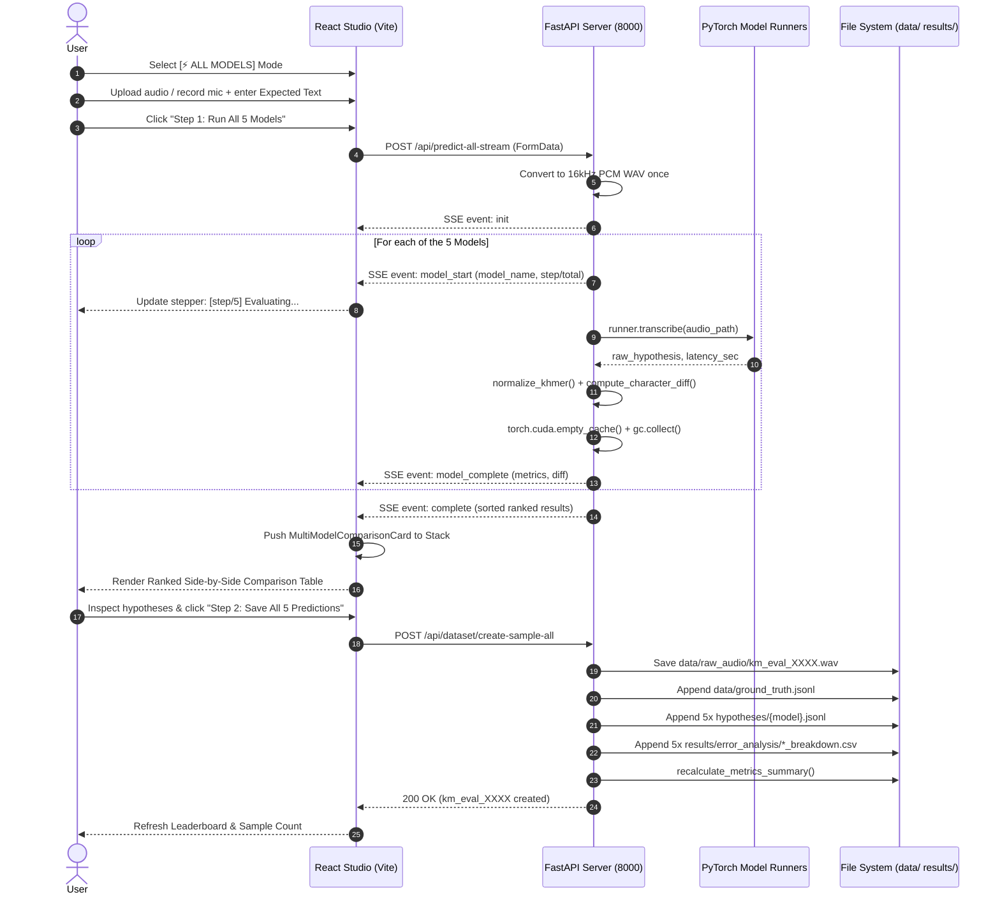

# Khmer ASR Multi-Model Evaluation Suite ("ALL Models") — Architecture & Technical Reference

## 1. Executive Summary & Objective

The **Multi-Model Evaluation Suite ("ALL Models")** is an integrated engine within the Khmer ASR Benchmarking Platform. It enables researchers and engineers to input a single audio sample (live microphone, file upload, or preloaded dataset sample) along with the expected Khmer ground truth text, and sequentially evaluate **all 5 benchmarked ASR models** against that exact recording in a single unified execution pass.

Following prediction, the platform renders a **side-by-side ranked comparative matrix** (sorted by Character Error Rate, CER %) and allows the user to **atomically commit the audio and all 5 predictions** into the repository's ground truth, hypothesis files, and error analysis breakdowns simultaneously.

```
                              AUDIO INPUT + EXPECTED TEXT
                                           │
                         [ ⚡ ALL MODELS ] Selected Mode
                                           │
             ┌─────────────────────────────┴─────────────────────────────┐
             │                                                           │
   Step 1: Predict All                                         Step 2: Commit All
(SSE Streaming Inference)                                  (Atomic Repository Sync)
             │                                                           │
┌────────────▼────────────────────────┐                     ┌────────────▼────────────────────────┐
│ Sequential Memory-Safe Runner       │                     │ Multi-File Atomic Persistence       │
│ 1. Google Speech / Chirp-2 (API)    │                     │ 1. data/raw_audio/km_eval_XXXX.wav  │
│ 2. Meta MMS-1B (Wav2Vec2 Adapter)   │                     │ 2. data/ground_truth.jsonl          │
│ 3. Sengtha Whisper Base (74M)       │                     │ 3. 5x hypotheses/{model}.jsonl      │
│ 4. Seanghay Qwen3-ASR (0.6B LLM)    │                     │ 4. 5x error_analysis/*_breakdown.csv│
│ 5. OpenAI Whisper Large v3 (1.55B)  │                     │ 5. results/metrics_summary.csv      │
└────────────┬────────────────────────┘                     └─────────────────────────────────────┘
             │
┌────────────▼────────────────────────┐
│ MultiModelComparisonCard            │
│ Ranked Side-by-Side Table (CER & S/I/D)
└─────────────────────────────────────┘
```

---

## 2. Core Problem Statements & Design Rationale

### A. The Dataset Asymmetry Problem
* **Prior Limitation:** Earlier versions allowed committing samples on a single-model basis. If sample `km_eval_0017` was added while evaluating `meta_mms_1b`, only Meta MMS recorded that sample in its breakdown CSV (`results/error_analysis/meta_mms_1b_cer_breakdown.csv`). The other 4 models remained at 16 samples.
* **Solution:** The `create-sample-all` workflow guarantees that every new benchmark sample is evaluated and committed across **all 5 models simultaneously**. The dataset remains **100% balanced and aligned** across sample count, duration, and metrics.

### B. GPU VRAM & Memory Exhaustion (CUDA OOM)
* **The Constraint:** The 5 models range in scale from 74M to 1.55B parameters. Instantiating and executing all 5 models concurrently on consumer GPUs (e.g., RTX 3050 / RTX 4060 with 4GB to 8GB VRAM) or on shared system RAM causes instant **CUDA Out of Memory** crashes or catastrophic paging thrashing.
* **Solution:** Models are executed in a strict **sequential FIFO queue**, paired with explicit post-inference memory reclamation (`torch.cuda.empty_cache()` and `gc.collect()`). The system never exceeds the peak memory footprint of the single largest active model.

### C. Latency & Browser HTTP Timeouts
* **The Constraint:** On CPU or modest GPUs, running all 5 models sequentially takes between 40 and 110 seconds (mainly dominated by Whisper Large v3). A standard blocking HTTP request risks browser timeout and provides zero feedback to the user for almost 2 minutes.
* **Solution:** Inference is exposed as a **Server-Sent Events (SSE) stream** (`/api/predict-all-stream`). The browser receives real-time progress updates (`model_start`, `model_complete`) and displays an active stepper (`[3/5] Evaluating Sengtha Whisper Base...`).

---

## 3. Four-Cluster Architectural Structure

The feature is organized into 4 decoupled, modular clusters:

### Cluster 1: Execution & Memory Safety (Backend Engine Layer)

* **Execution Order:**
  1. `google_chirp`: Cloud API call (network bound, ~5.4s, zero local VRAM).
  2. `meta_mms_1b`: Wav2Vec2 CTC acoustic model with `khm` adapter (~5.5s, fast CPU/GPU).
  3. `sengtha_whisper_base_khmer`: Lightweight 74M seq2seq model (~14.5s).
  4. `seanghay_qwen3_asr_0_6b`: Qwen3 Audio LLM Thinker (~17.7s).
  5. `openai_whisper_large_v3`: 1.55B multilingual model (~93s on CPU).

* **Memory Safety Routine:**
  Immediately following each local model's inference run:
  ```python
  if torch and torch.cuda.is_available():
      torch.cuda.empty_cache()
  gc.collect()
  ```

* **Fault Isolation:**
  Every model's transcription runs inside an isolated `try/except` block. If an individual model encounters an API timeout or decoding error, it records an `error` property and continues evaluating the remaining models without halting the suite.

---

### Cluster 2: Data Persistence & Synchronization (Storage Layer)

When committing a multi-model evaluation via `POST /api/dataset/create-sample-all`, the storage layer performs an **atomic synchronization sequence**:

1. **Auto-Index Resolution:**
   Calls `get_next_sample_id()` to calculate the next sequential index (e.g., `km_eval_0017`).
2. **Audio Normalization & Storage:**
   Converts the cached audio file to canonical 16kHz 16-bit mono PCM WAV and writes to:
   `data/raw_audio/km_eval_XXXX.wav`.
3. **Ground Truth Registration:**
   Appends a JSON record to `data/ground_truth.jsonl`:
   ```json
   {"id": "km_eval_0017", "audio_path": "data/raw_audio/km_eval_0017.wav", "duration": 12.98, "reference": "..."}
   ```
4. **5-Way Hypothesis Fanout:**
   Appends the prediction and latency to each model's hypothesis file:
   * `hypotheses/google_chirp.jsonl`
   * `hypotheses/meta_mms_1b.jsonl`
   * `hypotheses/sengtha_whisper_base_khmer.jsonl`
   * `hypotheses/seanghay_qwen3_asr_0_6b.jsonl`
   * `hypotheses/openai_whisper_large_v3.jsonl`
5. **5-Way Breakdown CSV Fanout:**
   Appends full evaluation metrics ($S, I, D, N_{\text{ref}}, N_{\text{hyp}}$, CER %, Latency) to:
   * `results/error_analysis/google_chirp_cer_breakdown.csv`
   * `results/error_analysis/meta_mms_1b_cer_breakdown.csv`
   * `results/error_analysis/sengtha_whisper_base_khmer_cer_breakdown.csv`
   * `results/error_analysis/seanghay_qwen3_asr_0_6b_cer_breakdown.csv`
   * `results/error_analysis/openai_whisper_large_v3_cer_breakdown.csv`
6. **Consolidated Metric Recalculation:**
   Invokes `recalculate_metrics_summary()`, updating `results/metrics_summary.csv`. All 5 models increment their sample count identically.

---

### Cluster 3: Transport & Communication Layer (REST + SSE)

#### A. Prediction Endpoint: `POST /api/predict-all-stream`
* **Content-Type:** `multipart/form-data`
* **Response Type:** `text/event-stream` (Server-Sent Events)
* **Form Parameters:**
  * `file`: Optional uploaded audio file (.wav, .mp3, .webm from mic).
  * `sample_id`: Optional ID of an existing preloaded dataset sample.
  * `expected_output`: Spoken Khmer ground truth text.

* **SSE Event Protocol:**
  ```text
  data: {"event": "init", "total_models": 5, "audio_filename": "upload_123.wav", "duration_sec": 12.98, "reference_raw": "..."}

  data: {"event": "model_start", "step": 1, "total": 5, "model_id": "google_chirp", "model_name": "Google Speech / Chirp"}

  data: {"event": "model_complete", "step": 1, "total": 5, "model_id": "google_chirp", "result": {...}}

  data: {"event": "model_start", "step": 2, "total": 5, "model_id": "meta_mms_1b", "model_name": "Meta MMS-1B"}

  ...

  data: {"event": "complete", "data": {"id": "batch_1730000", "is_multi_model": true, "results": [...]}}
  ```

#### B. Batch Commit Endpoint: `POST /api/dataset/create-sample-all`
* **Content-Type:** `multipart/form-data`
* **Form Parameters:**
  * `expected_output`: Spoken Khmer reference text.
  * `cached_filename`: Name of the transcoded audio file in `temp_uploads/`.
  * `results_json`: JSON stringified array of the 5 model evaluation results from Step 1.
  * `file`: Optional direct audio file upload.
* **Response:** JSON payload representing the newly created benchmark sample with `is_benchmark_sample: true` and the assigned `km_eval_XXXX` ID.

---

### Cluster 4: Frontend UI/UX Presentation Layer

1. **Model Architecture Selector (`ModelSelector.jsx`):**
   * Features a dedicated **`⚡ ALL MODELS`** badge button (`5 Models Suite`).
   * When active, displays the **Multi-Model Suite specifications strip**:
     * Evaluation Mode: `⚡ All 5 Models (Sequential SSE Suite)`
     * Architectures: `Conformer + Wav2Vec2 + Whisper + Qwen3`
     * Parameter Scope: `74M to 1.55B + Cloud API`
     * CER Span: `44.08% — 94.08%`
     * Output View: `Side-by-Side Ranked Matrix`
2. **Dynamic Execution Buttons (`AudioInputCard.jsx`):**
   * **Step 1:** `"Step 1: Run All 5 Models & Compare Side-by-Side"`
     * Live progress stepper: `[2/5] Evaluating Meta MMS-1B... (14s)`.
   * **Step 2:** `"Step 2: Save All 5 Predictions to Dataset (as km_eval_XXXX)"`
     * Activates only after Step 1 has completed.
3. **Multi-Model Comparison Card (`MultiModelComparisonCard.jsx`):**
   * Rendered automatically in the LIFO Evaluation Stack when `item.is_multi_model === true`.
   * **Side-by-Side Ranked Table:**
     * **Rank:** 🥇 1st, 🥈 2nd, 🥉 3rd, #4, #5 (sorted by lowest CER %).
     * **Model Identifier:** Name, architecture, and parameter size.
     * **Hypothesis:** Spoken Khmer transcription output.
     * **Edit Distance:** Substitutions ($S$), Insertions ($I$), Deletions ($D$).
     * **CER (%):** Color-coded pill (Green $\le 50\%$, Amber $50\text{–}70\%$, Red $>70\%$).
     * **Latency:** Execution time in seconds.
     * **Diff Inspector:** Dedicated `Diff` button opening an inline character alignment drawer.
4. **Stack CSV Export (`useAsrStack.js`):**
   * Automatically flattens multi-model suite items so every model's evaluation generates a standard row matching `results/error_analysis/*_cer_breakdown.csv`.

---

## 4. End-to-End Operational Sequence



---

## 5. Verification & Launch Instructions

To launch the full-stack suite with the ALL Models feature enabled:

```bash
# Terminal 1: Launch FastAPI Backend Server
.venv\Scripts\python.exe -m uvicorn scripts.server:app --host 127.0.0.1 --port 8000

# Terminal 2: Launch Vite Dev Frontend
cd frontend
npm run dev
# Accessible at http://localhost:5174 (or current active Vite port)
```

1. Navigate to the web application.
2. Click the **`⚡ ALL MODELS`** badge.
3. Input any audio sample and ground truth reference text.
4. Run Step 1 to observe the live SSE stepper and the ranked matrix table.
5. Run Step 2 to synchronize the sample across the entire project repository.
